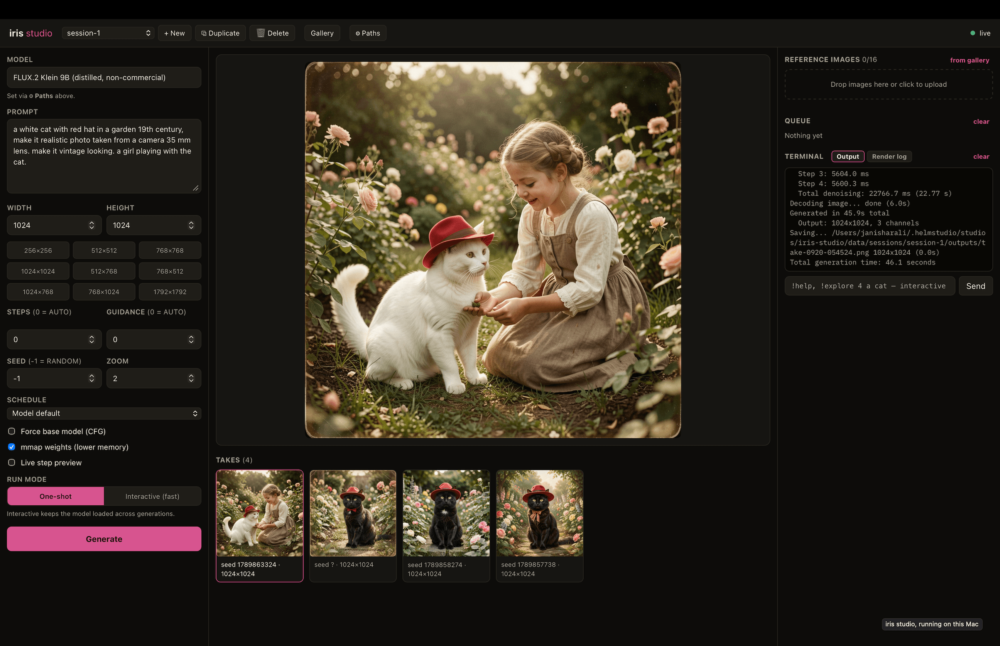

# iris studio

**A local web studio for [iris.c](https://github.com/janishar/iris.c)** — native
FLUX.2 Klein, FLUX.3 Image Klein and Z-Image image generation on Apple Silicon.

iris studio is a Go server (no JS build step, two Go dependencies) that drives
the `iris` binary: it builds the CLI arguments, runs one-shot or interactive
sessions, manages reference images, queues renders and streams live denoising
previews — in a browser tab, nothing sent off your machine. It runs as a
[helmstudio][helmstudio] studio and only that way: helmstudio installs it,
launches it, gives it the directory it keeps sessions in, and takes every
finished take into the library it shares with the other studios.

[](go.mod)
[](#requirements)
[](#license)

<p align="center">
  
</p>

## Motivation

Image diffusion on Apple Silicon usually means PyTorch's `mps` backend or a
node-graph app around it — slow for this workload, and holding far more unified
memory than the model needs. iris.c is a native Metal implementation of FLUX.2
Klein, FLUX.3 Image Klein and Z-Image with no PyTorch or MLX in the loop; iris
studio makes it a tool you can use, without a Python stack. The one exception
is optional: FLUX.3's prompt upsampler runs as a Python subprocess before a
render, and never on the path that makes pixels.

## Table of contents

- [Requirements](#requirements) · [Prompt upsampler](#prompt-upsampler) ·
  [Installation](#installation) —
  [Path A: the launcher](#path-a-install-from-the-launcher-recommended) ·
  [Path B: a checkout](#path-b-run-from-a-checkout) ·
  [`scripts/run.sh`](#what-scriptsrunsh-does) ·
  [Troubleshooting](#troubleshooting) · [Debugging](#debugging-and-vs-code)
- [Using the studio](#using-the-studio) — [Flags](#command-line-reference) ·
  [What helmstudio adds](#what-helmstudio-adds)
- [Features](#features) · [Sessions and state](#sessions-and-state) ·
  [Interactive mode](#a-note-on-interactive-mode)
- [Security](#security) · [Limits](#limits) ·
  [Contributing](#contributing) · [License](#license)

## Requirements

### Hardware and OS

macOS on Apple Silicon. The engine's Metal/MPS backend is what this is for;
iris.c also builds BLAS and generic backends for other platforms, untested
here. A checkpoint wants 16–30 GB of disk. Memory depends on image size: FLUX.3
Klein peaks near 35 GB at 1024×1024, the default size, and 85 GB at 1792×1792
(measured on a 64 GB M5 Pro, where the larger run swaps). Lower the size on
smaller machines.

### Toolchain

| | Why |
| --- | --- |
| **helmstudio's `helm`** | What runs iris studio. It does not start without it — see [Installation](#installation). |
| `git`, `make`, `gcc`, `xxd` | Building the engine, `make mps` in the `iris.c` submodule. These are what the Makefile and `helmstudio.yaml` name. |
| Go 1.27+ | Building the server. The first build fetches helmstudio's runtime SDK through the Go module proxy, so it wants the network once. |

### Checkpoints

One at a time: `--model` points at a single checkpoint directory, which is how
`iris` itself works. helmstudio downloads the one you choose at install and can
fetch the others later; a checkout links one you already have. What
`iris.c/download_model.sh` offers:

| Name | Steps | Disk | Notes |
| --- | --- | --- | --- |
| `4b` | 4 | ~16 GB | Distilled. The one to start with. |
| `4b-base` | 50 | ~16 GB | Base, CFG. |
| `9b` | 4 | ~30 GB | Distilled, **non-commercial** licence, gated. |
| `9b-base` | 50 | ~30 GB | Base, CFG, **non-commercial**, gated. |
| `zimage-turbo` | 9 | ~22 GB | Z-Image-Turbo 6B, Apache 2.0. |
| `flux3` | 16 | ~21 GB | FLUX.3 Image Klein distilled, trained for 4–16 steps. FLUX Kommunity licence, gated. |
| `flux3-base` | 50 | ~21 GB | FLUX.3 Image Klein base, CFG. FLUX Kommunity licence, gated. Not yet exercised by iris.c. |

The `9b` and `flux3` variants are gated on Hugging Face, each repository on its
own: accept the licence there, then pass `--token <your-token>` to
`download_model.sh`. Installing through the launcher instead, helmstudio asks
for the token itself.

FLUX.3 Image Klein is meant to run behind a prompt upsampler, and with Upsample
off, which is the default, iris studio sends prompts as typed: write them long
and detailed. See [Prompt upsampler](#prompt-upsampler).

## Prompt upsampler

Optional, and FLUX.3 only. `pup/` holds a small Python project that expands a
prompt into the caption the model is trained on. It needs
[uv](https://docs.astral.sh/uv/), about 0.8 GB of environment and the 19 GB
[`flux-3-image-klein-pup`](https://huggingface.co/black-forest-labs/flux-3-image-klein-pup)
checkpoint:

```bash
(cd pup && uv sync --locked)
```

The studio offers Upsample once `pup/.venv/bin/python` exists, the checkpoint is
FLUX.3 and a pup checkpoint is found: beside `--model` as
`flux-3-image-klein-pup` or `flux-3-klein-pup`, or wherever `--pup` or `/api/pup`
says. A caption runs as the job's first stage, loads for about 8 s, takes 22-44 s
and peaks near 21 GB, so a loaded interactive iris is unloaded first. Exiting is
what frees that memory.

The take keeps both the typed prompt and the caption. Captions are cached per
session in `captions/`, keyed on prompt, reference bytes, boxes and size, so a new
seed needs no upsampler. `/api/upsample` writes the caption without rendering.
Upsample caps references at 10, and a caption over iris's 1280 tokens is refused
before the render. `boxes` is a JSON list of objects with a string `id`, and needs Upsample: the
caption is how the model learns of them.

## Installation

Two ways in — **iris studio never starts on its own**, since whatever launches
it also gives it a session directory and the library it records takes into.

| | **A — Install it** | **B — Run from a checkout** |
| --- | --- | --- |
| For | using the studio | changing the studio |
| Needs | the **launcher**, helmstudio's daemon and web UI | the **`helm` CLI**; `helm dev` runs one studio, no daemon |
| Install | one click in its library | `git clone`, `make mps`, `bash scripts/run.sh` |
| Checkpoints | it downloads or links them | you point `IRIS_MODEL` at one |

### Path A: Install from the launcher (recommended)

The launcher clones this repository, runs the build steps in
[`helmstudio.yaml`](helmstudio.yaml) and fetches the checkpoint you pick.

**1. Install the launcher** — helmstudio itself, a daemon and a web UI. Either
**the Mac app** from [its releases][helm-releases], which bundles the daemon and
is **unsigned**, so macOS calls it damaged until you clear the quarantine flag
once (the release notes give the line); or a clone:

```bash
git clone https://github.com/janishar/helmstudio && cd helmstudio && make build && ./bin/helmstudio
```

Then open **http://127.0.0.1:8700**; everything lives in `~/.helmstudio`. Not
the `helm` installer — that is the studio author's CLI, with no library and no
gallery, and is what [Path B](#path-b-run-from-a-checkout) wants.

**2. Install iris studio from its library.** It is in helmstudio's registry, so
it is already listed. Install it and it first shows every command it will run
and every weight it could fetch: the engine (`make mps` in the submodule), the
server (`go build`), and which checkpoint to launch with. The others can be
fetched later.

**3. Start it.** The launcher gives the studio a port, the checkpoint's path and
a data directory of its own, then opens its page →
[Using the studio](#using-the-studio).

[helmstudio]: https://github.com/janishar/helmstudio
[helm-releases]: https://github.com/janishar/helmstudio/releases

### Path B: Run from a checkout

The developer's path: a checkout run against helmstudio's platform API, with
nothing installed into helmstudio. [`scripts/run.sh`](scripts/run.sh) builds the
server, links your checkpoint and starts everything under `helm dev`, so the
engine is the only thing you build by hand.

```bash
# 1. helm, the CLI that runs this checkout
/bin/bash -c "$(curl -fsSL https://raw.githubusercontent.com/janishar/helmstudio/main/installer/install.sh)"

# 2. the checkout, with iris.c as a submodule
git clone --recurse-submodules https://github.com/janishar/iris-studio && cd iris-studio

# 3. the engine → iris.c/iris, the one thing the script does not build
make mps -C iris.c

# 4. a checkpoint, if you have none — see Checkpoints above
(cd iris.c && ./download_model.sh 4b)

# 5. start, or restart; then `stop` to end it
IRIS_MODEL=$PWD/iris.c/flux-klein-4b IRIS_WEIGHT=flux_klein_4b bash scripts/run.sh
bash scripts/run.sh stop
```

`scripts/run.sh` needs a `helm` with `dev -select`, which is newer than
1.0.0-rc.3. All the checkpoints are `selectable`, so `{models.selected}` has to
be told which one to be; an install asks on its approval screen, and a checkout
has no approval screen. The script checks for the flag and says so rather than
failing on an unknown one.

### What `scripts/run.sh` does

1. **Checks** that `helm` is on `PATH`, that it has `dev -select`, and that
   `iris.c/iris` is built — naming the fix for each.
2. **Builds `./iris-studio`,** every run, because `helm dev` runs no build steps
   of its own and would otherwise launch whatever was there.
3. **Links the checkpoint** as `IRIS_WEIGHT` when `IRIS_MODEL` is set, per file:
   nothing is downloaded and the directory is never written to.
4. **Selects that checkpoint,** which is what `{models.selected}` resolves to.
5. **Runs `helm dev -f helmstudio.yaml`,** which supplies the platform, a data
   directory and the `/helm/` proxy. Extra arguments go to `helm dev`.

| Variable | Default | What it does |
| --- | --- | --- |
| `IRIS_MODEL` | *(none)* | Checkpoint directory to link. Needed on the first run only — `helm dev` records where the weight was linked. |
| `IRIS_WEIGHT` | `flux_klein_9b` | Which declared checkpoint that is, and which one to launch with. FLUX.3 is `flux_3_klein` or `flux_3_klein_base`. |
| `HELM` | `helm` | A particular `helm` instead of the one on `PATH`. |
| `IRIS_DLV` | *(none)* | Port to listen for a debugger on — see [below](#debugging-and-vs-code). |

Sessions and everything else the studio keeps go to `.helm/`, the pid file and
the debugger's shim to `.cache/iris-studio`; both are gitignored, and nothing is
written into the checkout.

### Troubleshooting

| What you see | What it means |
| --- | --- |
| `helm is not installed.` | Run the installer in [Path B](#path-b-run-from-a-checkout), or set `HELM`. |
| `this helm has no 'dev -select'` | The `helm` on `PATH` predates the flag. Build one from a helmstudio checkout and point `HELM` at it. |
| `iris.c/iris is not built` | `git submodule update --init --recursive`, then `make mps -C iris.c`. |
| `weights: no checkpoint at …` | `IRIS_MODEL` must name a directory holding `transformer/` and `vae/`. |
| `has no files matching …` or `it looks incomplete` | A linked FLUX.3 checkpoint also needs `text_encoder/`, and has to be whole. |
| A FLUX.3 checkpoint will not render from a checkout | `iris.c/iris` may be older than the submodule: `git submodule update --init --recursive`, then `make mps -C iris.c`. |
| `no checkpoint is chosen for this studio` | `IRIS_WEIGHT` names a weight the manifest does not declare. |
| `iris studio runs under helmstudio.` | The binary was started by hand. Use `bash scripts/run.sh`, or the launcher. |
| `/helm/` assets 404 | A stale `./iris-studio` — re-run the script. |
| `dlv is not installed` | `go install github.com/go-delve/delve/cmd/dlv@latest` |

### Debugging, and VS Code

```bash
IRIS_MODEL=/path/to/flux-klein-4b IRIS_WEIGHT=flux_klein_4b IRIS_DLV=2345 bash scripts/run.sh
```

`helm dev` hands the studio a restricted environment and the manifest names
`./iris-studio`, not a debugger — so the binary moves aside and that name
becomes a shim running it under [Delve][dlv] on the port, built `-N -l` so
stepping follows the source and given `--continue` so the studio starts instead
of waiting for a client. A run without `IRIS_DLV` builds over the shim.

VS Code has one launch configuration, because there is one way to run the
studio: **iris studio** (`F5`) runs **debug: iris studio** — the script with
`IRIS_DLV=2345` — and attaches the Go debugger; ending it runs **stop: iris
studio**. `.vscode/tasks.json` holds those and four more (**run: iris studio**
without the debugger, **build: iris studio**, **build: iris binary (mps)**,
**test: go (race)**) and the `IRIS_MODEL` each run uses.

[dlv]: https://github.com/go-delve/delve

## Using the studio

Write a prompt, pick a ratio, press **Add to queue**, as often as you like: a
render that arrives while another runs waits its turn. Choose **One-shot** or
**Interactive (fast)** in the left pane: interactive `iris` starts on **Load
model** or the first interactive render, so starting the studio never loads the
model. What each panel does is [Features](#features); where the work is kept is
[Sessions and state](#sessions-and-state).

### Command-line reference

You never type this — the launcher and `scripts/run.sh` both build it from
`helmstudio.yaml`'s `processes[0].cmd` — but the flags are worth knowing:

```bash
./iris-studio --iris ./iris.c/iris --model <checkpoint> --port <port> --root <data>
```

The paths are remembered in `<data>/sessions/iris.json` and `model.json`, so a
later launch can omit them; a flag or environment variable always wins.
**There is no authentication** — see [Security](#security) before binding to
anything but `127.0.0.1`.

| Flag | Default | Description |
| --- | --- | --- |
| `--root` | *(required)* | Directory holding `sessions/` — the data directory helmstudio gives this studio. It creates none of its own and will not start without one, and a take has to be inside it for helmstudio to adopt it. |
| `--iris` | `$IRISSTUDIO_IRIS`, else last used | Path to the built `iris` binary. |
| `--model` | `$IRISSTUDIO_MODEL`, else last used | Path to one checkpoint directory. |
| `--pup` | `$IRISSTUDIO_PUP`, else last used, else beside `--model` | Path to the prompt upsampler's checkpoint. Optional. |
| `--host` | `127.0.0.1` | Bind address. |
| `--port` | `8720` | Bind port; helmstudio passes the one it allocated. |
| `--allow-host` | *(none)* | Comma-separated extra `Host` header names to accept. IP addresses, `localhost` and `--host` are always accepted; anything else is refused, which is what blocks DNS rebinding. Needed only if you reach the studio by a name — see [Security](#security). |

Both paths are also changeable from **⚙ Paths** in the top bar while the studio
runs, which is how you switch checkpoints without a relaunch.

### What helmstudio adds

iris studio draws its own page — form, preview, takes rail, terminal — and
helmstudio adds four things around it:

| | |
| --- | --- |
| **Gallery** | helmstudio's own grid over this studio's takes, live: a take that finishes appears without a reload. Scoped to this studio; its library is where these sit beside other studios' work. |
| **References from anywhere** | **from gallery**, beside Reference images, picks an image out of that grid and copies it into this session's `inputs/`. It can be another studio's image — that is what a shared gallery is for. |
| **Render log** | A second Terminal tab streaming the render as helmstudio sees it; it reconnects after a dropped stream and says what it missed. Output's input line and **clear** hide while it shows — helm-terminal brings its own. |
| **The launcher** | A render appears there as a job with its progress and its log, so what this studio is doing is visible from outside it, and cancelling the job there stops the render. |

All of it arrives through the same-origin `/helm/` proxy the server mounts, as
do the theme and this studio's colour, so the page holds no token of
helmstudio's. If those components cannot load the page still works: the three
it puts on this page stay hidden, and everything else is untouched.

There is no timeline. A helmstudio sequence is an edit of video clips, and this
studio makes stills.

## Features

- **One checkpoint, switchable while it runs** — set at launch by `--model` and
  labelled automatically for the known FLUX.2 Klein, FLUX.3 Image Klein and
  Z-Image variants;
  change it from **⚙ Paths** in the top bar, which opens the same kind of
  path-editing modal as `--iris`.
- **Text-to-image and image-to-image** — upload reference images and combine up
  to 16 of them through iris's in-context multi-reference conditioning.
  References are ordered, and the model reads that order.
- **Aspect ratio** — **Auto** or one of seven ratio tiles; **Width** and
  **Height** override the ratio, from 64 to 1792 in multiples of 16, and stay
  empty to follow it. Auto renders 1024×1024, or with references takes the size
  iris gives the first one. The line under the tiles is the server's own answer
  for what the form comes to, so it can be read before a render is queued.
- **One-shot or interactive** — one-shot spawns a fresh `iris` per generation
  (simplest, reloads the weights every time); interactive keeps one `iris` REPL
  loaded, so repeated generations skip a weight load that costs seconds to
  minutes. A one-shot render unloads it first, because two loaded checkpoints
  would stack past the memory peak.
- **Live step preview** — with **Live step preview** on, each denoising step's
  intermediate frame streams into the browser over the same Kitty graphics
  protocol iris uses for terminal display.
- **Schedules** — model default (FLUX.3's own is a FlowMatch with shift 6.93),
  linear, power curve (with α), shifted sigmoid for FLUX.2, FlowMatch Euler for
  Z-Image.
- **Sessions** — each keeps its own references, takes and settings, and
  switching is instant. **+ New**, **⧉ Duplicate** and **🗑 Delete** are in the
  top bar. The form saves itself a moment after you change it.
- **Queue** — one list across every session, each row reading prompt · size ·
  seed with its own **cancel**; a size reads **auto** until the take exists, and
  a row from another session names it. You can
  queue a render and move on: its frames, its take and its log show only in the
  session that asked for it.
- **Terminal panel** — raw `iris` output streams live, for the session on
  screen, up to the last 2000 lines; when interactive mode is loaded you can
  type REPL commands (`!explore 4 a cat`, `!help`, …) into it. That is all the
  input line does — it is not a shell, see [Security](#security).

## Sessions and state

A session is a directory under the data directory helmstudio gives as `--root`,
holding one line of work: inputs, outputs and the UI state that produced them.
Nothing is shared between sessions, so switching is instant. For an installed
studio that root is `~/.helmstudio/studios/iris-studio/data`; for a checkout
under `helm dev` it is `./.helm/data`. Nothing is written into the repository.

```
sessions/<name>/
├── setting.json     # the session's form, saved as it changes
├── terminal.log     # this session's terminal output
├── inputs/          # uploaded reference images
└── outputs/         # generated PNGs, each with a <name>.json sidecar of run metadata
```

- **`inputs/`** is the *only* place renders read references from. Uploads,
  takes pulled back with **Use as reference**, and images picked out of
  helmstudio's gallery all land here first.
- **`outputs/`** holds only what `iris` produced: the PNG and its sidecar.
  Deleting the image deletes its sidecar.
- `sessions/last_session.json` tracks the last active session and is restored on
  start, creating `session-1` if empty. `sessions/iris.json` and
  `sessions/model.json` remember the paths, so a later launch can omit them.

A finished take becomes helmstudio's too, without changing any of the above: it
is written to `outputs/` as always, and helmstudio adopts it **by hardlink** —
the same bytes under a second name, one inode, counted once. The gallery item
carries the sidecar's parameters plus the session name as `iris_session`, since
helmstudio checks session ids against its own and these are not those. Deleting
a take here does not undo that: the hardlink keeps the bytes and the gallery
item stays, so a take you want gone must go there too.

## A note on interactive mode

`iris_cli.c`'s REPL works over a pipe: it falls back to plain line reading when
stdin is not a TTY, and it line-buffers stdout, so each line reaches the studio
as it is printed. The studio goes by what iris says:

- A render is finished when iris prints `Done -> `, and failed when it prints
  `Error: `. The temp directory iris writes to is not watched, because it also
  holds a copy of every `!load`.
- Reference `$N` ids count from 1, and every image iris loads or generates takes
  the next one. The studio reads them from iris's `Loaded: ` and `Done -> ` lines,
  so a prompt typed into the terminal cannot shift them. A failed `!load` takes
  no id, so after a failed render the studio loads its references again.
- A render with a size puts it first on its prompt line, after any `$N`. `!load`
  sets the REPL's size to the reference's, and behind a size the prompt is plain
  text, so one that starts with `!` or `$`, or ends in `1024x1024`, runs no
  command, takes no reference and changes no size. An Auto render with references
  sends no size, so iris sizes it from the first one and the prompt goes bare:
  one starting with `$`, or starting or ending in a size like `1024x1024`, is
  refused.
- A random seed is reported truthfully in both modes. Interactive iris prints the
  seed it uses. One-shot iris prints one and renders with a later clock reading,
  so for a one-shot render the studio picks the seed and passes it.
- Repeating a prompt and seed in interactive mode gives a slightly different
  image on a distilled checkpoint: the repeat uses iris's 4-bit quantized copy of
  the embedding, so two sidecars that read the same can describe different images.
- `!explore` images are throwaway previews. iris writes none of them to disk, so
  they never become takes. Their seeds are in the terminal: `!seed <n>` and the
  same prompt renders one at full size.

The two modes print progress differently (`  Step 2/4 …` from the one-shot CLI,
`[2/4]:` from the REPL) and the studio reads both.

The strip under the preview follows Load, Encode, Denoise, Decode and Save from
what iris prints, so a stage lights when it happens and a finished one shows its
time: iris's own `done (0.8s)` where it prints one, the studio's clock otherwise.
Denoise fills by step, and the row below it keeps the elapsed time, with an ETA
from the second step on. A stage iris never reached by denoising shows as
skipped, which in practice means a repeated prompt in interactive mode: a held
REPL has its transformer, but it let its text encoder go, so a new prompt still
shows Load. Between renders the strip says what the next one will use, and after
a Generate it keeps that render's times until the form changes. It shows only the
session on screen, or a render typed into the terminal, which has no Cancel and
goes back to idle when it ends.

## Security

iris studio has **no authentication**. Read this before binding it to anything
but `127.0.0.1`.

- It binds to `127.0.0.1` by default. Anyone who can reach the port can run
  renders and read every take in every session. Nothing in the guard below is
  a substitute for that: it stops a *web page you visit* from reaching the
  studio, not someone who can reach the port.
- **There is no shell.** The terminal panel types into interactive `iris` and
  nothing else; a line `iris` does not recognise is an error from `iris`. The
  studio no longer hands anything to `/bin/sh`, and there is no flag that
  brings that back. h3 studio keeps the feature behind `--allow-shell` because
  it is started from a command line; iris studio is started by helmstudio from
  the manifest, where a flag nobody can reach would only be the same hole with
  a longer name.
- **Every request is checked before it is routed**
  (`guard`, `server/handlers.go`):
  - The `Host` header must name this server — an IP literal, `localhost`,
    `--host`, or a name passed to `--allow-host`. This is what blocks DNS
    rebinding: a name the attacker controls, re-pointed at `127.0.0.1`.
  - A state-changing request must be same-origin. An `Origin` from anywhere
    else is refused, and with no `Origin` at all a `Sec-Fetch-Site:
    cross-site` is refused.
  - It must carry `application/json`. A cross-site page cannot send that
    without a CORS preflight, which the browser then refuses. This is what
    closes the `text/plain` POST that used to reach every route: the body is
    no longer decoded whatever the content type says.
  - Two exceptions, both for requests that are preflighted anyway. `/api/upload`
    is a raw body named by an `X-Filename` header, and a custom header forces
    the preflight by itself. The `/helm/` proxy also takes the content types
    helmstudio's SDK writes in — a `+json` merge patch, or no content type on
    a body-less `:cancel`/`DELETE` — neither of which a cross-site form can
    send.
- Everything the page uses of helmstudio's comes through the same-origin
  `/helm/` proxy, so the browser never holds helmstudio's token. The proxy
  forwards the studio API and the theme stream and nothing else — a launcher
  path (install, launch, stop) 404s and never reaches the daemon.

What is still open: **⚙ Paths** changes the `iris` binary and the checkpoint
from the browser (`/api/iris`, `/api/model`), and the binary is then executed.
The guard puts that out of reach of another page, but not of anyone who can
reach the port. It is kept because switching checkpoints without a relaunch is
what the panel is for.

`server/guard_test.go` holds the cases, including the cross-site POST that
used to run a shell command.

## Limits

- One render at a time, deliberately. Up to 200 wait behind it; a render past
  that is refused rather than held. A reference a waiting or running render
  uses, and the session it belongs to, cannot be deleted until the render is
  over.
- Cancel sends `SIGTERM` to iris's process group, then `SIGKILL` after 2
  seconds. An interactive render has only the REPL to stop, so Cancel unloads the
  model and the next render loads it again. iris reads `!quit` only between
  renders, so it is killed if it has not gone within 5 seconds. **Unload** does
  the same, and the render then ends as failed rather than cancelled.
- Progress lags a step: iris writes `  Step 2/4 ` without a newline, so the
  line only arrives when the next step begins with one. The stage still lights
  on time, because the studio also reads the line iris has not finished.
- Recording happens as a take finishes and nothing is reconciled afterwards: a
  take deleted here stays in helmstudio's gallery.
- `/api/busy` answers helmstudio's busy contract, so its switch-studio dialog
  reads iris studio as busy during any render, one typed into the terminal
  included. A prompt counts from the line where iris says `Generating`, so a
  render queued in the instant before that line is not held back. A line typed
  while one generates is refused.
- `server/interactive_test.go` runs the interactive path against a stub REPL.
  The real one is verified by hand.

## Contributing

Bug reports, feature requests and pull requests are all welcome. Two
conventions worth knowing: no Go dependencies beyond helmstudio's runtime SDK,
and no front-end build step — `static/` is served as written.
Run `go test -race ./...` before opening one.

Engine issues — generation quality, speed, Metal kernels, checkpoint support —
belong in [iris.c's own repository](https://github.com/janishar/iris.c).

## License

MIT
